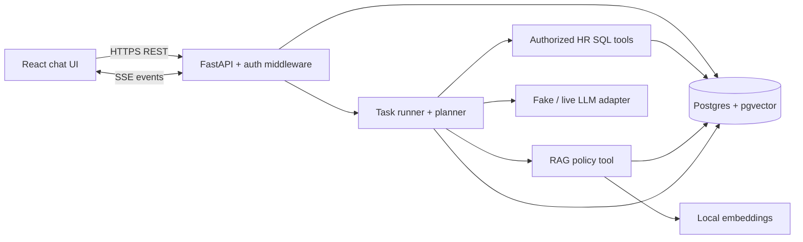
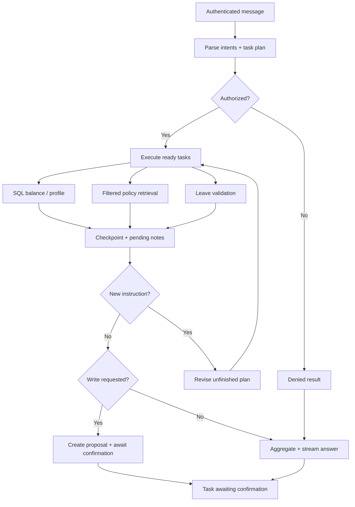

# DOCUMENT 2 — Technical Design Document

## 1. Architectural decision

**Recommendation:** Modular monolith: React/Vite/TypeScript UI; FastAPI API and async task runner; PostgreSQL + pgvector; local Sentence Transformers embeddings; a small explicit planner/executor with tool registry; a fake LLM for deterministic tests and selectable real LLM adapter for live demo. Use Alembic migrations, Pydantic request/response validation and SQLAlchemy 2.x async sessions. Compose services: `db`, `api`, `web` (optional one-shot `migrate` or `seed`). A separate worker/Redis is **not mandatory**; if task execution outlives processes, use PostgreSQL task claiming with leases and recovery checkpoints. Document the single-node demo limitation.



**Trust boundaries:** Browser untrusted; authenticated claims verified on API. Tools get immutable `ActorContext(user_id, company_id, role)` from backend, never constructed by LLM. Retrieved document chunks untrusted; may contain malicious text. Database writes happen only in explicit confirmation service, not a generic autonomous SQL executor.

## 2. Technology selection matrix

| Technology | Purpose / reason | Alternative | Classification |
|---|---|---|---|
| Python 3.12+ | backend/test/tool logic, straightforward typing | Node/Go | M: Python |
| FastAPI | async REST/SSE, dependency injection, OpenAPI | Django/Starlette | E: recommended, PDF allows FastAPI |
| Pydantic v2 | typed API payloads, errors, strict validation | attrs/dataclasses | E |
| SQLAlchemy 2.x | parameterized queries/transaction control | psycopg direct | E |
| Alembic | repeatable schema changes | SQL migrations | E |
| PostgreSQL | transactional structured state | no alternative within assignment | M |
| pgvector | embedding search inside Postgres | external vector DB | M |
| Sentence Transformers `all-MiniLM-L6-v2` | local real embeddings, 384 dimensions, keyless testing | BGE-small, E5-small | E choice, real embedding M |
| pgvector cosine distance | normalized semantic matching | inner-product/L2 | E |
| Custom planner/executor | explicit multi-step DAG, easy deterministic tests | LangGraph StateGraph | E architecture; multi-step M |
| Live OpenAI/Gemini adapter | streamed natural answer | local Ollama/model | E; any LLM allowed |
| React + TS + Vite | crisp, type-safe chat UX | vanilla HTML/JS | E, simple chat UI M |
| SSE | one-way event stream with reconnect | WebSocket | E implementation; streaming M |
| Docker Compose | repeatable multi-service setup | devcontainers | M |
| Structured JSON logs | debugging tasks safely | plain logs | E |
| PostgreSQL RLS | defense in depth on tenant-scoped tables | app-only filters | E for take-home, recommended strongly |

Avoid Kafka/Kubernetes/multi-agent swarms/Redis until demonstrated operational need. A single orchestrator with several tools is *genuine multi-task orchestration*.

## 3. Request routing and tool policy

Deterministic rule-first intent classifier with LLM-assisted intent parsing when needed. **Talk** for greeting or conceptual questions not needing records; **search** for company policy claims; **SQL** for live balances/profiles/histories; **parallel tools** when intents independent; **clarify** when dates or subject ambiguous; **propose** when a request is a data mutation; **refuse** when tenant/role/ownership fails. Crucially, forbidden retrieval is blocked in SQL before text enters the model.

### Tool contracts

| Tool | Input (actor supplied by server) | Output | Side effect / authorization / errors |
|---|---|---|---|
| `search_hr_policy` | query, top_k | permitted snippets + policy IDs/versions | read-only; tenant+role+status prefilter; empty answer if no match |
| `get_leave_balance` | optional self subject | days_left, as_of | read-only, self only; 403 on other user |
| `get_employee_profile` | self | safe profile | read-only; protected fields excluded |
| `get_leave_history` | cursor, limit | self history | read-only; pagination |
| `validate_leave_request` | ISO dates, leave type | valid, days, warnings | read-only; date/overlap check; policy rules configurable |
| `create_leave_proposal` | validated request + task | proposal ID/version/expiry | **only proposal metadata write**; no leave balance/request mutation |
| `confirm_leave_proposal` | proposal ID, expected version | booking ID, balance | actual write after direct authenticated action; transaction lock |
| `cancel_leave_proposal` | proposal ID | cancelled status | proposal-only update; ownership check |

Tool output is typed JSON, not instructions. The orchestrator does not expose arbitrary SQL queries or arbitrary document-read tools to the LLM.

## 4. Agent graph / execution lifecycle



Keep `original_request` immutable. `TaskState` stores a monotonically increasing `revision`, subtasks `{id, kind, dependencies, status, input_hash, result}`, `pending_instructions`, `last_event_seq`, `current_generation`. Independent reads run concurrently using `asyncio.TaskGroup`; validate before propose; any booking executes only upon a separate confirm API call. If user changes a previously completed result requirement, append an amendment subtask; do not mutate/delete prior event history.

## 5. Mid-run instruction algorithm (critical)

1. `POST /tasks/{id}/instructions` authenticates actor, locks task row, appends a `task_messages` record and increments `instruction_revision`, emits `task.updated`, and returns 202 immediately. It **does not start a new task**.
2. Runner polls pending messages at safe boundaries: before every tool call, after tool completion, before answer composition and between short streaming chunks, plus on cancellation signal. Since an ongoing LLM request cannot reliably read a new DB row mid-inference, optionally cancel the current LLM generation, checkpoint already produced text as superseded, and restart generation from original request + new note + completed results. Say so in UI.
3. Planner merges original intent list with new notes using a precedence rule: latest explicit instruction governs conflicting future behavior, but may not override security restrictions or approved writes. Distinguish adding a new task from rewriting an existing one.
4. Tool idempotency key = `(task_id, semantic_operation, canonical_inputs_hash, plan_revision)` for reads; writes additionally use proposal ID with DB uniqueness. Already-completed identical reads may be reused; materially changed inputs require a new subtask.
5. If cancelled: transition `cancelling` -> `cancelled` at checkpoint; do not run remaining work; pending proposal cancelled/expired explicitly. If process crashes: on restart, reclaim expired task lease, load events/subtasks, resume idempotent steps; never auto-confirm pending proposals.
6. If several browser tabs submit notes concurrently, serialize updates in DB transaction and use monotonically increasing instruction revisions. SSE clients dedupe by event ID.

**Important limitation:** Mid-token interruption is cancellation/restart at a safe boundary, not supernatural modification of a model call in progress. Document how fast checkpoints occur and expose superseded answer segments as needed.

## 6. Streaming and event persistence

SSE GET `/api/v1/tasks/{task_id}/events` responds `text/event-stream`; cookie auth; `Cache-Control: no-cache`; periodic `: heartbeat`. Events persisted before delivery:

```
id: 42
event: tool.completed
data: {"task_id":"...","seq":42,"at":"...","revision":2,"payload":{"tool":"get_leave_balance","status":"ok"}}

```

Event types: `task.started`, `task.planning`, `tool.started`, `tool.completed`, `assistant.delta`, `task.updated`, `task.awaiting_confirmation`, `task.completed`, `task.failed`, `task.cancelled`. Client uses `Last-Event-ID` or `?after=42`; event IDs monotonically increase per task, server replays `seq > after`. React reduces events keyed by `(task_id, seq)`; do not append duplicate text twice. Reconnect with backoff; use exact persisted status in UI. Concurrent sends from same conversation append notes to active task by default, new task only through explicit separate “new task” action. Enforce one active orchestrator lease per task.

## 7. RAG pipeline

Upload (E) -> verify MIME/size, tenant and uploader rights -> virus scan in production (P) -> extract text -> normalize Unicode/layout -> split into 400-token chunks with 60-token overlap (initial tunable values) -> attach `company_id`, `visibility`, allowed user IDs or role, `version`, `status=published`, provenance SHA-256, timestamps -> embed locally using `sentence-transformers/all-MiniLM-L6-v2` (384 dimensions) -> store in `vector(384)` -> SQL prefilter with tenant/access/status **before** rank/LLM context -> order by cosine distance (`<=>`) -> top 5 -> validate document IDs/access again -> quote with stable citations/title/version -> final answer with source references. Start with exact cosine scan for tiny test data; HNSW index with `vector_cosine_ops` for larger sample; with approximate indexes and restrictive filters, tune iterative scanning or use exact scoped ranking to avoid missing permitted results. Do **not** treat a similarity threshold as a security control; optional calibrated threshold for answer abstention.

**Prompt injection control:** Retrieved text is tagged as *untrusted document text*. Tool and permission boundaries enforce no cross-tenant search and no restricted pay lookup regardless of instruction claims. A poisoned source cannot turn its text into tool calls. Strip untrusted markup, cap chunk sizes, validate cited source IDs; still rely primarily on authorization and tool allowlists. Tests must prove no leaked Pebble or CEO salary text under poisoned retrieval.

## 8. Leave transaction pattern

Proposal creation stores intended change only. Confirm endpoint checks ownership, expiry, `status=pending`, expected version; within one DB transaction `SELECT ... FOR UPDATE` on proposal and balance, revalidate date overlap, calculate days, ensure balance sufficient, insert leave_request, decrement balance (if demo books immediately), mark proposal confirmed, add audit record, commit. `UNIQUE(confirmed_proposal_id)` and version prevent replay. Race between two proposals handled via row lock + balance check. If policy requires manager approval instead of immediate booking, leave request can be submitted/pending without decrement; choose *one* explicit demo convention.

## 9. Security posture

- Auth: hashed seeded credentials (Argon2/bcrypt) and signed HTTP-only Secure SameSite cookie or bearer for tests; API must derive tenant+role server-side.
- RBAC: policy visibility via DB predicates; HR access scoped to Summit only; self data by actor ID.
- RLS: apply `company_id` session variable under least-privileged app role via `SET LOCAL`, policy on tenant-owned tables; transaction pooling requires careful session handling. RLS is additional guard, not replacement for API auth.
- SQL injection: SQLAlchemy bound parameters; no raw SQL from model.
- Sensitive output: avoid logging policy full text, embeddings for sensitive docs, tokens, salaries or leave PII; mask audit change details where needed.
- Prompt injection: source text never influences authorization or tool selection at privilege level; explicit denial test.
- Inputs: size/rate limits; safe file extensions; valid ISO date ranges; HTML render escaping; no Markdown raw HTML injection.
- Tools: allowlisted typed functions, server-side scoped actor and output validation.
- Abuse: rate limits in API (E), TLS/reverse proxy and secret manager in production (P).
- Audit: record actor/action/target/result/time without logging sensitive unrestricted data.

## 10. Real separate tenant databases

If companies already use isolated DBs, a **database-per-tenant** design is preferable when isolation/data-residency demands justify it. A control-plane DB stores tenant routing metadata and global application tasks/users (or federated identities); each tenant HR DB stores policies, balances and local HR data. Tenant router maps authenticated company to allowlisted connection DSN/secret, never takes DSN/tenant from user/LLM. Separate SQLAlchemy engine pools per configured tenant, bounded and lazily initialized; credentials may have only tenant-local permissions. Apply migrations per tenant with version tracking and rollout/rollback plan. Avoid cross-database joins and data movement; orchestration stores only opaque tenant-scoped references in shared task records. Backup/key rotation per tenant. Tradeoffs: stronger isolation and independent scaling, but more operations, connections, migrations and consistency complexity. For two seeded companies, **single Postgres with tenant-tagged tables, robust RLS and app checks** is appropriate.

## 11. Production vs assignment priorities

**Build now:** strict authorization, real embedding retrieval, exact seed facts, persistent task events, deterministic fake LLM tests, human-gated write transaction, concise UI and reproducible Docker. **Consider next:** retry/lease hardening, migrations/policy versioning, managed secrets, alerts, backups, SSO, CI/CD, realistic cost/latency telemetry. Skip infrastructure theater; document omissions honestly.
