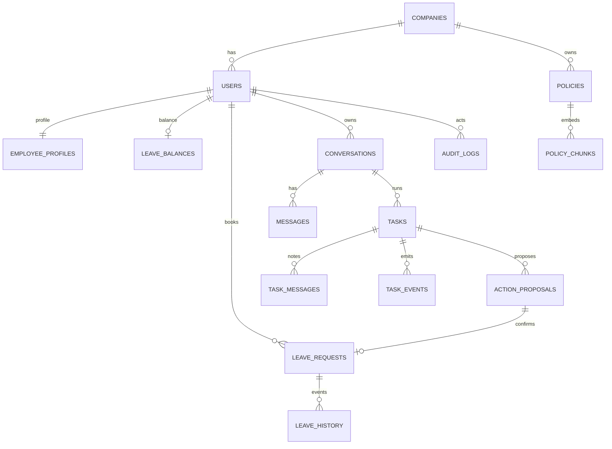

# DOCUMENT 3 — Database Schema, ER Diagram and API Contracts

## 1. Data architecture and conventions

PostgreSQL 16+ with `CREATE EXTENSION vector;` and `CREATE EXTENSION pgcrypto;`. UUID PKs (`gen_random_uuid()`), UTC `timestamptz`, immutable creation timestamps, per-tenant foreign keys, strict check constraints. All tenant-owned tables include `company_id` except global `companies`. For composite tenant FK integrity create `UNIQUE(company_id,id)` on referenced rows and foreign keys `(company_id,foreign_id) REFERENCES parent(company_id,id)`. Foreign keys should not allow a row from one tenant to reference another. No LLM-generated SQL.

### Schema catalog

| Table | Columns / types (PK marked *) | Constraints, indexes, security |
|---|---|---|
| `companies` | `id* uuid`, `slug varchar(40)`, `name text`, `active bool`, `created_at timestamptz` | UNIQUE slug; globally non-secret directory |
| `users` | `id* uuid`, `company_id uuid`, `username text`, `password_hash text`, `role text`, `active bool`, `created_at` | FK company, UNIQUE(company_id,username), CHECK role in ('employee','hr'), index(company_id,role), RLS |
| `employee_profiles` | `id* uuid`, `company_id`, `user_id uuid`, `display_name text`, `department text`, `employment_start date` | UNIQUE(company_id,user_id), tenant composite FK users; self/authorized HR read |
| `policies` | `id* uuid`, `company_id`, `slug text`, `title text`, `body text`, `visibility text`, `allowed_user_id uuid?`, `version int`, `status text`, `source_filename text`, `source_sha256 char(64)`, `is_demo bool`, `ingested_at`, `published_at` | UNIQUE(company_id,slug,version), CHECK visibility in ('all','hr','specific_user'), status in ('draft','published','retired'), tenant FK on allowed user, index(company_id,status,visibility), RLS |
| `policy_chunks` | `id* uuid`, `company_id`, `policy_id`, `chunk_no int`, `chunk_text text`, `embedding vector(384)`, `created_at` | UNIQUE(policy_id,chunk_no), composite FK policies, index(company_id,policy_id), HNSW cosine optional; RLS |
| `leave_balances` | `id* uuid`, `company_id`, `user_id`, `days_left numeric(6,2)`, `version int`, `updated_at` | UNIQUE(company_id,user_id), CHECK days_left>=0, self-only read, row lock on write |
| `leave_requests` | `id* uuid`, `company_id`, `user_id`, `start_date date`, `end_date date`, `days numeric(6,2)`, `status text`, `confirmed_proposal_id uuid`, `created_at` | CHECK end>=start, days>0, UNIQUE confirmed_proposal_id, overlapping request validation under lock; self access |
| `leave_history` | `id* uuid`, `company_id`, `user_id`, `request_id`, `event_type text`, `days_delta numeric`, `occurred_at`, `actor_id` | FK tenant scoped, index(company_id,user_id,occurred_at), append-only |
| `conversations` | `id* uuid`, `company_id`, `owner_user_id`, `title text`, `created_at`, `updated_at` | composite FK user, index(company_id,owner_user_id), owner only |
| `messages` | `id* uuid`, `company_id`, `conversation_id`, `sender text`, `body text`, `created_at` | CHECK sender, index(conversation_id,created_at), owner only |
| `tasks` | `id* uuid`, `company_id`, `conversation_id`, `owner_user_id`, `original_request text`, `status text`, `instruction_revision int`, `plan jsonb`, `lease_owner text?`, `lease_until timestamptz?`, `created_at`, `updated_at` | CHECK status in ('queued','running','awaiting_confirmation','completed','failed','cancelling','cancelled'), index(status,lease_until), RLS owner |
| `task_messages` | `id* uuid`, `company_id`, `task_id`, `user_id`, `instruction text`, `revision int`, `created_at` | UNIQUE(task_id,revision), tenant FK, append-only |
| `task_events` | `id* uuid`, `company_id`, `task_id`, `seq bigint`, `event_type text`, `payload jsonb`, `created_at` | UNIQUE(task_id,seq); replay index(task_id,seq), RLS owner |
| `action_proposals` | `id* uuid`, `company_id`, `task_id`, `owner_user_id`, `action_type text`, `payload jsonb`, `status text`, `version int`, `expires_at`, `confirmed_at`, `created_at` | CHECK status pending/confirmed/cancelled/expired, index(company_id,owner_user_id,status), RLS self; separate uniqueness of booking |
| `audit_logs` | `id* uuid`, `company_id`, `actor_user_id`, `action text`, `object_type text`, `object_id uuid`, `outcome text`, `metadata jsonb`, `created_at` | append-only; redact secrets; company scoped |

**Option to simplify:** `messages` can represent all user messages and `task_messages` only mid-run notes. Retain both only with documented semantics. `leave_history` records state transitions and balance deltas, not a second source of truth for balances.

## 2. Entity relationship diagram



## 3. Concrete SQL patterns

```sql
CREATE EXTENSION IF NOT EXISTS vector;
CREATE EXTENSION IF NOT EXISTS pgcrypto;

CREATE TABLE companies (
  id uuid PRIMARY KEY DEFAULT gen_random_uuid(),
  slug text NOT NULL UNIQUE,
  name text NOT NULL,
  active boolean NOT NULL DEFAULT true,
  created_at timestamptz NOT NULL DEFAULT now()
);

CREATE TABLE policies (
  id uuid PRIMARY KEY DEFAULT gen_random_uuid(),
  company_id uuid NOT NULL REFERENCES companies(id),
  slug text NOT NULL,
  title text NOT NULL,
  body text NOT NULL,
  visibility text NOT NULL CHECK (visibility IN ('all','hr','specific_user')),
  allowed_user_id uuid,
  version integer NOT NULL CHECK (version > 0),
  status text NOT NULL CHECK (status IN ('draft','published','retired')),
  source_filename text NOT NULL,
  source_sha256 char(64) NOT NULL,
  is_demo boolean NOT NULL DEFAULT false,
  ingested_at timestamptz NOT NULL DEFAULT now(),
  published_at timestamptz,
  UNIQUE(company_id, slug, version),
  UNIQUE(company_id,id)
);

CREATE TABLE policy_chunks (
  id uuid PRIMARY KEY DEFAULT gen_random_uuid(),
  company_id uuid NOT NULL,
  policy_id uuid NOT NULL,
  chunk_no int NOT NULL,
  chunk_text text NOT NULL,
  embedding vector(384) NOT NULL,
  created_at timestamptz NOT NULL DEFAULT now(),
  UNIQUE(policy_id,chunk_no),
  FOREIGN KEY(company_id,policy_id) REFERENCES policies(company_id,id)
);

-- Illustrative scoped retrieval; join to parent before constructing model context.
SELECT p.id, p.title, p.version, c.chunk_text,
       (c.embedding <=> :query_embedding) AS cosine_distance
FROM policy_chunks c
JOIN policies p ON p.id=c.policy_id AND p.company_id=c.company_id
WHERE p.company_id=:actor_company
  AND p.status='published'
  AND (p.visibility='all' OR (p.visibility='hr' AND :actor_role='hr')
       OR (p.visibility='specific_user' AND p.allowed_user_id=:actor_user))
ORDER BY c.embedding <=> :query_embedding
LIMIT 5;
```

The actual Alembic migration must implement all catalog tables, composite tenant FKs, index details, RLS and backfills, not assume this sample is a complete executable schema. When using `SET LOCAL app.tenant_id`, apply it inside every transaction and RLS policy to enforce company scope; consider `FORCE ROW LEVEL SECURITY` and an app DB role without `BYPASSRLS`. Employee-self restrictions remain additionally enforced by endpoint policy.

**Confirmation transaction pseudocode:** begin -> lock proposal -> compare owner/company/expected version/status/expiry -> lock balance -> verify proposed dates, balance and overlap -> insert leave request referencing proposal (unique) -> update balance/version -> mark proposal confirmed -> append leave history+audit -> commit. On conflict rollback with 409; no partial balance debit.

## 4. API baseline conventions

All routes prefixed `/api/v1`; all except login/health authenticated. JSON error envelope: `{"error":{"code":"forbidden","message":"Access denied","request_id":"..."}}`. JSON dates ISO 8601; UUID identifiers server-issued; `Idempotency-Key` on mutating operations if practicable. Reject unknown fields. 400 invalid query, 401 unauthenticated, 403 unauthorized, 404 absent or inaccessible object (choose non-enumerating 404 for cross-tenant), 409 conflict/stale, 422 invalid domain inputs, 429 rate limit, 503 temporary outage. Pagination with cursor and bounded limit (1–100).

### Endpoint contract table

| Method / path | Auth & authorization | Request | Successful response | Validation / errors |
|---|---|---|---|---|
| `POST /auth/login` | public | `{username,password}` | 200 `{user,company,role}` + HttpOnly cookie | 401 invalid, throttled; no tenant trust from client |
| `POST /auth/logout` | signed-in | empty | 204; cookie cleared | 401 |
| `GET /me` | signed-in | none | `{id,username,company:{slug,name},role}` | 401 |
| `GET /conversations` | owner | `?cursor&limit` | `{items,next_cursor}` | 422 limit |
| `POST /conversations` | signed-in | `{title?}` | 201 `{id,title}` | 422 bad title |
| `GET /conversations/{id}` | owner | none | `{id,messages,tasks}` | 404 other tenant/user |
| `POST /conversations/{id}/tasks` | owner | `{message}` | 202 `{task_id,status:'queued',events_url}` | 422 empty; 409 if task already running and should be note |
| `POST /tasks/{id}/instructions` | task owner, active status | `{message}` | 202 `{task_id,revision,status}` | 409 completed/cancelled, 404 foreign |
| `GET /tasks/{id}` | task owner | none | `{id,original_request,status,revision,plan,proposal?}` | 404 foreign |
| `GET /tasks/{id}/events` | task owner | `?after=<seq>` + Last-Event-ID | `text/event-stream` | 404 foreign, 422 bad seq |
| `POST /tasks/{id}/cancel` | owner | `{reason?}` | 202 `{status:'cancelling'}` | 409 terminal |
| `POST /policies/ingest` | HR of own tenant (E) | multipart file + visibility, version | 202 `{document_id,status:'draft'}` | 403 employee, 415 file, 413 size |
| `GET /policies/search` | signed-in | `?q&limit` | `{sources:[{id,title,version,snippet}]}` | enforced tenant/RBAC; 422 bad q |
| `GET /leave/balance` | signed-in self | none | `{days_left,as_of}` | 404 no row |
| `GET /leave/history` | signed-in self | `?cursor&limit` | `{items,next_cursor}` | self only |
| `POST /leave/proposals` | signed-in self | `{task_id,start_date,end_date,leave_type}` | 201 `{id,version,days,status,expires_at}` | 422 missing/invalid/insufficient; 409 overlap |
| `POST /leave/proposals/{id}/confirm` | proposal owner | `{expected_version}` | 200 `{request_id,status,remaining_days}` | 409 expired/stale/already confirmed; 404 foreign |
| `POST /leave/proposals/{id}/cancel` | proposal owner | `{expected_version}` | 200 `{id,status:'cancelled'}` | 409 state; 404 foreign |
| `GET /health/live` | public | none | 200 `{status:'ok'}` | no dependencies required |
| `GET /health/ready` | internal | none | 200 `{db:'ok',vector:'ok'}` | 503 unhealthy |

For `POST /tasks` while one job already exists, the UI should send its message to `/tasks/{id}/instructions` by default. Do not silently create another job. Optional user-visible “New task” action can deliberately start a separate task.

### Request/response examples

**Create multi-intent task**
```http
POST /api/v1/conversations/73a.../tasks
Content-Type: application/json

{"message":"Tell me my remaining leaves, explain my late policy, and prepare 3 days of leave"}
```
```json
{"task_id":"a5b...","status":"queued","events_url":"/api/v1/tasks/a5b.../events"}
```

**Add a note to running task**
```http
POST /api/v1/tasks/a5b.../instructions
Content-Type: application/json

{"message":"Make the answer shorter, and use bullet points"}
```
```json
{"task_id":"a5b...","revision":2,"status":"running"}
```

**SSE replay**
```text
id: 17
event: task.updated
data: {"task_id":"a5b...","seq":17,"revision":2,"payload":{"note_accepted":true}}

id: 18
event: assistant.delta
data: {"task_id":"a5b...","seq":18,"revision":2,"payload":{"text":"You have 12 days..."}}

```

**Create/approve proposal** (demonstration dates only, not implied by assignment)
```json
{"task_id":"a5b...","start_date":"2026-11-16","end_date":"2026-11-18","leave_type":"annual"}
```
```json
{"id":"b12...","version":1,"days":3,"status":"pending","expires_at":"2026-11-04T12:00:00Z"}
```
```http
POST /api/v1/leave/proposals/b12.../confirm
Content-Type: application/json

{"expected_version":1}
```
```json
{"request_id":"c45...","status":"booked","remaining_days":9}
```

**Authorization:** all object URLs are looked up under authenticated `(company_id,owner_user_id)`; never distinguish confidential existence through errors. An LLM cannot issue confirm; only API user action. If browser uses cookie auth, require origin checks and CSRF token for POST/PUT/DELETE; SSE GET remains authenticated.

## 5. SQLAlchemy / Alembic recommendations

Create `Base` with UUID mixins, tenant composite foreign keys, `Mapped[...]`, explicit `Enum`/CHECK constraints, SQLAlchemy `select()` not string concatenation. `alembic revision --autogenerate` is a draft; review migrations manually for RLS, vector extension, index operator class, FK order and reversible steps. Initial revision creates extension + tables; second creates scoped indexes/RLS; third seeds via separate idempotent script (seeds should generally not be hard-coded into schema migrations). Test upgrade from empty DB and downgrade in throwaway DB.
